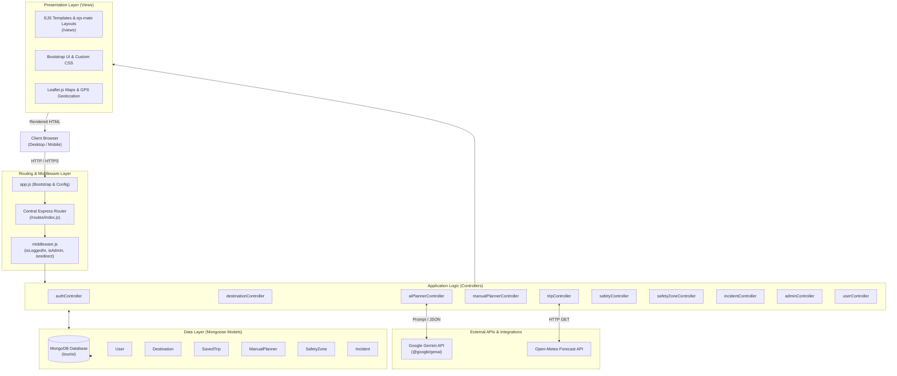
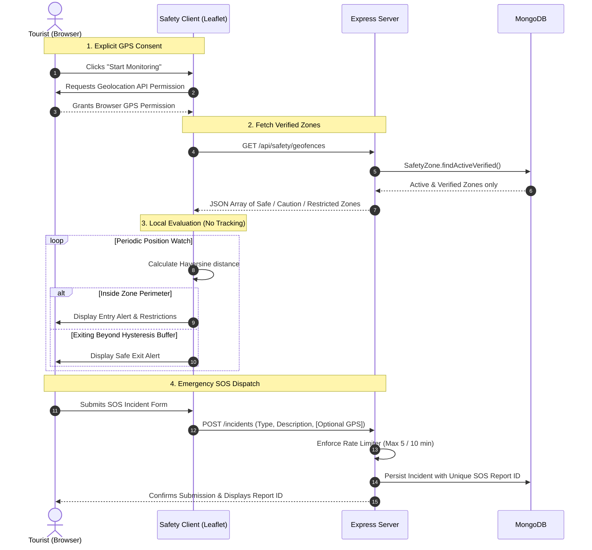

# Maharashtra Tourism Platform — Smart Eco & Cultural Tourism

[](https://nodejs.org/)
[](https://expressjs.com/)
[](https://mongoosejs.com/)
[](https://www.passportjs.org/)
[](https://leafletjs.com/)
[](https://ai.google.dev/)
[](#testing--quality-assurance)

> An end-to-end full-stack web application designed to promote cultural, heritage, and eco-tourism across Maharashtra. Features comprehensive destination directories, customized manual and AI-assisted multi-day itinerary builders, live travel companion tracking with real-time weather integration, and a tourist safety monitoring engine with consent-based GPS geofencing and emergency SOS incident reporting.

---

## Table of Contents

- [Project Overview](#project-overview)
- [Key Features](#key-features)
- [System Architecture](#system-architecture)
- [Technology Stack](#technology-stack)
- [Project Directory Structure](#project-directory-structure)
- [Installation and Local Setup](#installation-and-local-setup)
- [Environment Variables](#environment-variables)
- [Application Screenshots & Visual Walkthrough](#application-screenshots--visual-walkthrough)
- [API and Route Reference](#api-and-route-reference)
- [Safety, Geofencing & Privacy Architecture](#safety-geofencing--privacy-architecture)
- [Testing & Quality Assurance](#testing--quality-assurance)
- [Future Enhancements](#future-enhancements)
- [License & Academic Disclaimer](#license--academic-disclaimer)
- [Author & Acknowledgements](#author--acknowledgements)

---

## Project Overview

Maharashtra possesses an extraordinary wealth of tourism assets — from UNESCO World Heritage rock-cut caves (Ajanta & Ellora) and Sahyadri hill forts (Raigad, Rajgad, Pratapgad) to Konkan coastal beaches, wildlife sanctuaries, and pilgrimage centres. However, tourists frequently face key challenges:

1. **Fragmented Information:** Destination details, entry regulations, opening hours, and fee structures are scattered across multiple sources.
2. **Complex Itinerary & Budget Planning:** Travelers lack integrated tools to organize multi-day journeys, group destinations logically, and estimate costs across transport, food, and ticketing.
3. **Safety Vulnerabilities in Remote / Hazardous Areas:** Monsoon landslides, remote fort trekking trails, and wildlife buffer zones present real risks. Tourists often enter hazardous or unverified zones without real-time boundary warnings or direct emergency reporting mechanisms.

### The Solution

The **Maharashtra Tourism Platform** is a web-based digital ecosystem engineered with **Node.js, Express, MongoDB, EJS, and Leaflet** to resolve these pain points:

- **Centralized Tourism Discovery:** Curated destinations with district-level filtering, categorizations, ratings, fee breakdowns, and rich location metadata.
- **Dual Trip Planning Engines:**
  - *Manual Planner:* Interactive drag-and-drop/selection staging where users build custom day-by-day itineraries, allocate activities, and calculate granular budgets.
  - *AI Trip Planner:* Google Gemini-powered engine generating tailored day-wise itineraries based on starting city, pace, interests, and traveler count.
- **Smart Trip Companion:** Turn-by-turn live trip tracker persisting completed activities and pulling 7-day weather forecasts and storm warnings via Open-Meteo.
- **Tourist Safety Monitoring & Geofencing:** Client-side GPS tracking with explicit user consent, calculating distances against active, verified safety zones using the Haversine formula and hysteresis buffers to avoid false triggers.
- **SOS Incident Reporting & Governance:** Rate-limited incident dispatching with optional coordinate submission, tracking report history, and providing an administrative triage workflow.

---

## Key Features

### 1. Destination Discovery & Exploration
- **Categorized Directory:** Explore destinations grouped into Historical, Nature, Wildlife, Beach, Hill Station, Religious, Trekking, Family, and Cultural landmarks.
- **Search & Filtering:** Search by keyword, district (e.g., Pune, Raigad, Ratnagiri, Aurangabad), or category.
- **Rich Place Profiles:** View high-resolution imagery, historical background, best visiting season, opening/closing hours, dual fee schedules (Indian vs. International visitors), and interactive Leaflet map pins.

### 2. User Authentication & Authorization
- **Passport.js Local Strategy:** Secure registration, salted password hashing via `passport-local-mongoose`, and session management.
- **Role-Based Access Control (RBAC):** Distinct permissions separating standard tourists from administrators.
- **Flash Notifications:** Real-time feedback for logins, edits, validations, and permission checks.

### 3. Manual Trip Planner
- **Destination Staging:** Add places directly from the explore catalog into a personal staging area.
- **Multi-Day Itinerary Builder:** Create structured schedules across custom dates with specified travel group sizes and budgets.
- **Granular Cost Breakdown:** Automated computation of travel/fuel, accommodation, dining, entry fees, and miscellaneous expenses.
- **Full CRUD Management:** View, edit, recalculate, and delete saved manual itineraries.

### 4. AI-Assisted Trip Planner
- **Powered by Google Gemini (`@google/genai`):** Dynamic generation of realistic itineraries based on input constraints (origin city, interest focus, budget category, duration).
- **Structured JSON Synthesis:** Validates and converts AI output into standardized day-by-day schedules with estimated costs and recommendations.
- **One-Click Itinerary Saving:** Persist AI-generated itineraries directly into the user's permanent trips collection.

### 5. Smart Trip Companion & Live Navigation
- **Live Trip Execution:** View active itinerary days, scheduled activities, and destination addresses.
- **Activity Checklists:** Check off visited destinations with immediate AJAX progress synchronization (`currentDayIndex`, `completedActivityIds`).
- **Integrated Weather Forecasts:** Fetches real-time temperature, humidity, precipitation probability, and severe weather warnings (thunderstorms, heavy rainfall, heat advisories) from Open-Meteo.

### 6. Tourist Safety Map & Geofencing Engine
- **Consent-First Geolocation:** GPS monitoring only activates after explicit user agreement (`Start Monitoring`).
- **Haversine Geofencing:** Evaluates user distance against polygon and radial zones in real time.
- **Hysteresis Thresholding:** Buffer zones prevent flickering enter/exit notifications when users linger near boundary perimeters.
- **Emergency Hotlines:** One-click dialers for National Emergency (112), Police (100), Ambulance (108), and Tourist Helpline (1363).

### 7. SOS Incident Reporting & Administrative Triage
- **Incident Dispatching:** Category validation (`medical_emergency`, `lost_tourist`, `accident_injury`, `unsafe_restricted_area`, etc.).
- **Optional GPS Attachment:** Coordinates and accuracy metadata attached only if explicit consent is granted.
- **Rate-Limiting Defense:** In-memory rate limiting restricts submissions to a maximum of 5 reports per 10 minutes per IP/User to prevent abuse.
- **Admin Workflow:** Administrators can inspect incident queues, view location coordinates, write internal notes, and update statuses (`Pending` &rarr; `In Progress` &rarr; `Resolved` / `Rejected`).

### 8. Safety Zone Governance
- **Administrative Zone Creation:** Register restricted forest reserves, landslide-prone ghats, or caution zones with mandatory official government citation URLs.
- **Strict Verification Lifecycle:** Newly added zones default to `pending` and are **strictly excluded** from public safety alerts until verified by an administrator.

---

## System Architecture

The project follows a clean **Model-View-Controller (MVC)** design pattern, separating concerns between data models, business logic, route definitions, and presentation templates.



---

## Technology Stack

| Layer | Technologies & Libraries | Purpose |
|---|---|---|
| **Runtime Environment** | Node.js (v18.x or higher) | Server-side JavaScript runtime |
| **Web Framework** | Express.js (v5.x) | Application routing, middleware pipeline, and REST APIs |
| **Architecture** | MVC Pattern with `express.Router()` | Modular separation of concerns |
| **Database & ODM** | MongoDB, Mongoose (v9.x) | Document storage, schema definitions, validation, and indexing |
| **Templating Engine** | EJS (Embedded JavaScript), `ejs-mate` | Server-rendered views, layouts, and reusable partials |
| **Frontend UI** | Bootstrap 5, FontAwesome, Custom CSS | Responsive layout, modern cards, modals, and navigation |
| **Mapping & Location** | Leaflet.js, OpenStreetMap, HTML5 Geolocation API | Interactive destination maps, radial geofences, GPS coordinates |
| **Authentication & Security** | Passport.js, `passport-local`, `passport-local-mongoose` | Salted hashing, session authentication, route guards |
| **Session Management** | `express-session`, `connect-flash`, `method-override` | Stateful user sessions, flash alerts, RESTful PUT/DELETE simulation |
| **AI Integration** | Google Gemini Generative AI (`@google/genai`) | Automated intelligent trip itinerary synthesis |
| **External APIs** | Open-Meteo Free Forecast API, Axios | Real-time weather, precipitation data, and severe weather advisories |
| **Testing Framework** | Native Node.js `assert`, Custom E2E Test Suite | End-to-end integration and unit testing across models and routes |

---

## Project Directory Structure

```text
Maharashtra/
├── app.js                          # Clean application bootstrap & configuration (71 lines)
├── middleware.js                   # Authentication (isLoggedIn) and authorization (isAdmin) guards
├── aiplanner.js                    # Core Google Gemini prompt generation & parsing logic
├── package.json                    # Project metadata, dependencies, and test/start scripts
├── package-lock.json               # Locked dependency tree
├── .env.example                    # Template for required environment variables
├── .gitignore                      # Git exclusion rules (node_modules, .env, logs)
│
├── config/                         # Infrastructure & setup configurations
│   ├── db.js                       # Mongoose database connection & safety zone seeding
│   └── passport.js                 # Passport LocalStrategy & user serialization setup
│
├── models/                         # Mongoose data schemas & validation logic
│   ├── user.js                     # User model with role field (user / admin)
│   ├── destination.js              # Tourist destination schema with coordinates & fees
│   ├── savetrip.js                 # Saved multi-day itineraries & companion progress state
│   ├── manualPlanner.js           # Staging collection for manual itinerary items
│   ├── safetyZone.js               # Geofence zones, verification status, and geometry
│   └── incident.js                 # Emergency SOS incident reports schema
│
├── controllers/                    # Business logic & request handling
│   ├── authController.js           # Signup, login, and logout workflows
│   ├── destinationController.js    # Explore page, place details, CRUD & JSON API
│   ├── manualPlannerController.js  # Staging destinations, planner workspace & compiling
│   ├── aiPlannerController.js      # Gemini AI itinerary generation & persistence
│   ├── tripController.js           # Saved trips list, companion tracker, progress & weather
│   ├── safetyController.js         # Safety dashboard, public geofences API & SOS reporting
│   ├── safetyZoneController.js     # Admin safety zone CRUD, verification & active toggle
│   ├── incidentController.js       # Admin incident oversight, detail inspection & triage
│   ├── adminController.js          # Admin dashboard aggregation metrics
│   └── userController.js           # User management directory & role updates
│
├── routes/                         # Modular Express router endpoints
│   ├── index.js                    # Root router, static pages & sub-router mounting
│   ├── auth.js                     # Authentication routes (/login, /signup, /logout)
│   ├── destinations.js             # Place exploration, details, admin CRUD & API
│   ├── manualPlanner.js            # Manual trip planner & staging routes
│   ├── aiPlanner.js                # AI planner & trip generation endpoints
│   ├── trips.js                    # Saved trips, companion mode, progress & weather
│   ├── safety.js                   # Safety dashboard, public geofences & SOS reporting
│   └── admin.js                    # Protected admin routes (/dashboard, /admin/*)
│
├── views/                          # Server-rendered EJS templates
│   ├── layout/
│   │   └── boilerplate.ejs         # Master HTML wrapper with navbar, footer & scripts
│   ├── include/
│   │   ├── navbar.ejs              # Responsive animated navigation bar
│   │   ├── footer.ejs              # Application footer & emergency helpline links
│   │   └── flash.ejs               # Reusable flash message alert banners
│   ├── tourism/
│   │   ├── index.ejs               # Landing page with hero section & featured districts
│   │   ├── explore.ejs             # Destination catalog with category filters
│   │   ├── show.ejs                # Comprehensive single destination view
│   │   ├── mplanner.ejs            # Manual trip planner workspace & budget calculator
│   │   ├── planner.ejs             # AI trip planner form
│   │   ├── tripresult.ejs          # Itinerary display view
│   │   ├── mytrips.ejs             # User's saved trips dashboard
│   │   ├── tripcompanion.ejs       # Live turn-by-turn companion & weather widget
│   │   ├── safety.ejs              # Safety map, geofence monitor & SOS report form
│   │   ├── myincidents.ejs         # User's reported incident history
│   │   ├── incidentDetails.ejs     # Detailed incident inspection page
│   │   └── about.ejs               # About Maharashtra tourism page
│   ├── admin/
│   │   ├── dashboard.ejs           # Admin analytics & metric counters
│   │   ├── places.ejs              # Destination directory management
│   │   ├── new.ejs                 # Add new destination form
│   │   ├── editPlace.ejs           # Edit destination form
│   │   ├── users.ejs               # User directory & role assignment
│   │   ├── safetyZones.ejs         # Geofence zones verification list
│   │   ├── safetyZoneForm.ejs      # Add/edit geofence zone form
│   │   └── incidents.ejs           # Emergency SOS incident management
│   ├── user/
│   │   ├── signup.ejs              # Registration form
│   │   └── login.ejs               # Login form
│   └── footer/
│       ├── privacy.ejs             # Privacy policy & GPS disclosure
│       └── term.ejs                # Terms and conditions
│
├── public/                         # Static assets served directly
│   ├── css/
│   │   └── style.css               # Custom theme styling & responsive adjustments
│   ├── js/
│   │   └── script.js               # Bootstrap form validation & UI helpers
│   └── image/                      # Stock placeholders and branding graphics
│
├── init/                           # Database seeding scripts & sample data
│   ├── index.js                    # Seed runner for initial tourist places
│   ├── sampledata.js               # Sample dataset of Maharashtra tourist destinations
│   ├── safetyZones.js              # Initial safety zone dataset & seeder function
│   └── data.js                     # Extended tourism dataset
│
└── test/                           # Automated test suites (216 tests)
    ├── adminDashboard.test.js      # Admin dashboard aggregation & model tests
    ├── app.test.js                 # Authentication, E2E public & protected route tests
    ├── manualPlanner.test.js       # Manual planner staging, compilation & budget tests
    ├── safety.test.js              # Geofence hysteresis, rate-limiting & SOS tests
    └── adminHttp.test.js           # Admin route HTTP 302 protection checks
```

---

## Installation and Local Setup

### Prerequisites
- **Node.js**: v18.0.0 or higher
- **npm**: v9.0.0 or higher
- **MongoDB**: Community Server v6.0+ running locally (default: `mongodb://127.0.0.1:27017`) or a MongoDB Atlas URI
- **Google Gemini API Key**: Required for AI trip planning (obtainable free from [Google AI Studio](https://aistudio.google.com/))

### Step-by-Step Instructions

1. **Clone the repository:**
   ```bash
   git clone https://github.com/waghsanket155-dev/maharashtra-tourism-platform.git
   cd maharashtra-tourism-platform
   ```

2. **Install project dependencies:**
   ```bash
   npm install
   ```

3. **Configure Environment Variables:**
   Copy the provided `.env.example` file to create your local `.env`:
   ```bash
   cp .env.example .env
   ```
   Open `.env` in your editor and configure your variables:
   ```env
   PORT=8080
   MONGO_URI=mongodb://127.0.0.1:27017/tourist
   SESSION_SECRET=your_custom_secret_key
   GEMINI_API_KEY=your_actual_gemini_api_key
   BASE_URL=http://localhost:8080
   ```

4. **Seed the Database with Sample Destinations:**
   Ensure your local MongoDB daemon is running, then populate initial destinations:
   ```bash
   npm run seed
   ```
   *(Note: Verified safety zones are automatically initialized by `config/db.js` on first server boot).*

5. **Start the Application:**
   ```bash
   npm start
   ```

6. **Access the Application:**
   Open your browser and navigate to:
   ```text
   http://localhost:8080
   ```

---

## Environment Variables

The application references the following environment variables:

| Variable | Type | Default Value | Description |
|---|---|---|---|
| `PORT` | Number | `8080` | Port on which the Express HTTP server listens |
| `MONGO_URI` | String | `mongodb://127.0.0.1:27017/tourist` | Connection string for the MongoDB instance |
| `SESSION_SECRET` | String | `ndjfqejiofjew` | Secret key used to sign the session ID cookie |
| `GEMINI_API_KEY` | String | *None* | Google Gemini API key used by `@google/genai` for itinerary generation |
| `BASE_URL` | String | `http://localhost:8080` | Target host used by the end-to-end automated test suites |

> [!CAUTION]
> Never commit your `.env` file to version control. The repository's `.gitignore` explicitly excludes `.env` to prevent accidental credential leakage.

---

## Application Screenshots & Visual Walkthrough

Capture and place your actual application screenshots in `public/screenshots/` (or `docs/screenshots/`) using the suggested views below:

| View | Description | Suggested Screenshot File |
|---|---|---|
| **Home Page** | Hero section highlighting Maharashtra's biodiversity, heritage forts, and quick navigation cards | `docs/screenshots/01_home_page.png` |
| **Explore Destinations** | Grid catalog with district and category filters (Historical, Hill Stations, Beaches, Wildlife) | `docs/screenshots/02_explore_catalog.png` |
| **Destination Details** | High-resolution photography, entry fee table, opening hours, and location coordinates | `docs/screenshots/03_destination_details.png` |
| **Manual Trip Planner** | Staging drawer, day-by-day activity builder, and real-time budget calculator | `docs/screenshots/04_manual_planner.png` |
| **AI Trip Planner** | Gemini AI prompt form and generated day-wise itinerary view | `docs/screenshots/05_ai_planner.png` |
| **Smart Trip Companion** | Turn-by-turn tracker with completed activity checklist and Open-Meteo live weather widget | `docs/screenshots/06_trip_companion.png` |
| **Safety & Geofencing Map** | Leaflet radar map showing active safety zones, user GPS marker, and helpline dialers | `docs/screenshots/07_safety_map.png` |
| **Admin Dashboard** | Central governance panel displaying destination counts, user management, and incident triage | `docs/screenshots/08_admin_dashboard.png` |

---

## API and Route Reference

The application exposes 66 routes organized into modular controllers:

### 1. Public & Informational Endpoints
| Method | Route | Description | Auth Required |
|---|---|---|---|
| `GET` | `/` or `/home` | Application landing page | No |
| `GET` | `/about` | Overview of Maharashtra eco and cultural tourism | No |
| `GET` | `/explore` | Filterable catalog of all destinations | No |
| `GET` | `/touristplaces/:id` | Full details, fees, and coordinates for a destination | No |
| `GET` | `/api/destinations` | JSON endpoint returning destination names, districts & fees | No |
| `GET` | `/booking` | Redirects to the official MTDC portal (`https://www.mtdc.co/`) | No |
| `GET` | `/privacy` / `/term` | Privacy policy, GPS disclosure, and terms of service | No |

### 2. User Authentication Endpoints
| Method | Route | Description | Auth Required |
|---|---|---|---|
| `GET` | `/signup` | Render user registration form | No |
| `POST` | `/signup` | Process registration and auto-login | No |
| `GET` | `/login` | Render user login form | No |
| `POST` | `/login` | Authenticate credentials and restore redirected URL | No |
| `GET` | `/logout` | Terminate session and redirect to `/explore` | No |

### 3. Trip Planning & Companion Endpoints
| Method | Route | Description | Auth Required |
|---|---|---|---|
| `GET` | `/m-planner` | Manual trip planner workspace & staged places | Yes (`isLoggedIn`) |
| `POST` | `/m-planner/:destinationId` | Add destination to personal planner staging area | Yes (`isLoggedIn`) |
| `DELETE`| `/m-planner/:destinationId` | Remove destination from staging area | Yes (`isLoggedIn`) |
| `POST` | `/save-manual-trip` | Compile and save structured manual itinerary | Yes (`isLoggedIn`) |
| `GET` | `/planner` | Render AI trip planner input form | Yes (`isLoggedIn`) |
| `POST` | `/plan-trip` | Query Gemini AI to generate custom itinerary | Yes (`isLoggedIn`) |
| `POST` | `/save-trip` | Persist AI-generated itinerary to user profile | Yes (`isLoggedIn`) |
| `GET` | `/my-trips` | View all saved manual and AI itineraries | Yes (`isLoggedIn`) |
| `GET` | `/my-trips/:id` | View single saved trip itinerary | Yes (`isLoggedIn`) |
| `GET` | `/my-trips/:id/start` | Launch live Smart Trip Companion mode | Yes (`isLoggedIn`) |
| `POST` | `/my-trips/:id/progress` | AJAX endpoint updating completed activities | Yes (`isLoggedIn`) |
| `POST` | `/my-trips/:id/complete`| Mark trip as completed | Yes (`isLoggedIn`) |
| `GET` | `/api/trips/weather` | Fetch 7-day forecast & storm alerts for coordinates | Yes (`isLoggedIn`) |

### 4. Tourist Safety & SOS Endpoints
| Method | Route | Description | Auth Required |
|---|---|---|---|
| `GET` | `/safety` | Interactive safety map & emergency panel | Yes (`isLoggedIn`) |
| `GET` | `/api/safety/geofences` | Returns only active & verified safety zones (JSON) | Yes (`isLoggedIn`) |
| `POST` | `/incidents` | Dispatch SOS emergency report (rate-limited) | Yes (`isLoggedIn`) |
| `GET` | `/my-incidents` | View user's own submitted incident reports | Yes (`isLoggedIn`) |
| `GET` | `/my-incidents/:id` | View specific incident status and notes | Yes (`isLoggedIn`) |

### 5. Administrative Endpoints
| Method | Route | Description | Auth Required |
|---|---|---|---|
| `GET` | `/dashboard` | Metrics dashboard (places, users, zones, reports) | Admin (`isAdmin`) |
| `GET` | `/places` | Manage destination catalog directory | Admin (`isAdmin`) |
| `GET` | `/admin/new` | Form to create a new destination | Admin (`isAdmin`) |
| `POST` | `/places` | Create new destination | Admin (`isAdmin`) |
| `POST` | `/places/:id` | Update destination details | Admin (`isAdmin`) |
| `DELETE`| `/places/:id` | Delete destination | Admin (`isAdmin`) |
| `GET` | `/admin/users` | User management directory & role filter | Admin (`isAdmin`) |
| `POST` | `/admin/users/:id/role` | Elevate or demote user administrative role | Admin (`isAdmin`) |
| `GET` | `/admin/safety-zones` | Safety zone governance & verification queue | Admin (`isAdmin`) |
| `POST` | `/admin/safety-zones` | Create new safety zone (defaults to `pending`) | Admin (`isAdmin`) |
| `POST` | `/admin/safety-zones/:id/verify` | Verify or reject safety zone | Admin (`isAdmin`) |
| `POST` | `/admin/safety-zones/:id/toggle-active`| Toggle safety zone active state | Admin (`isAdmin`) |
| `GET` | `/admin/incidents` | Incident management dashboard | Admin (`isAdmin`) |
| `PATCH`| `/admin/incidents/:id/status` | Update incident status (`In Progress`, `Resolved`, etc.) | Admin (`isAdmin`) |

---

## Safety, Geofencing & Privacy Architecture

The platform prioritizes tourist well-being and privacy through transparent design choices:



### Safety Guarantees & Privacy Constraints
1. **No Passive Tracking:** Continuous GPS coordinates are evaluated **locally in the tourist's browser** via the Haversine algorithm. Coordinates are **never** streamed to or stored on the server during passive monitoring.
2. **Explicit Consent for SOS:** When dispatching an SOS incident report, attaching GPS coordinates is entirely optional and requires an explicit checkbox toggle.
3. **Zone Governance:** Unverified zones submitted by contributors or administrators remain in `pending` status and are **strictly excluded** from public safety alerts until verified with an official source citation (e.g., government gazette, forest department notification).
4. **Emergency Services Clarification:** Submitting an in-app SOS report logs an incident for platform administrators and local coordinators. **It does not automatically dispatch police or medical vehicles.** The UI prominently provides direct touch-to-call buttons for official helplines:
   - **National Emergency:** `112`
   - **Police Assistance:** `100`
   - **Ambulance:** `108`
   - **Tourist Helpline:** `1363`

---

## Testing & Quality Assurance

The application features a comprehensive, multi-layer automated test suite executed with Node's native assertion library, testing models, route guards, full HTTP lifecycles, and geofencing logic.

### Test Execution Command

Run the complete test suite:
```bash
npm test
```

### Verified Test Results

The test suite consists of **216 automated tests across 4 test suites**, achieving **100% pass rate (0 failures)**:

```text
============================================================
TEST SUITE SUMMARY
============================================================
1. test/adminDashboard.test.js      12 Passed / 0 Failed
   - RBAC middleware validation (isAdmin allow/redirect)
   - Destination model CRUD & district aggregation
   - User promotion, demotion, and deletion
   - Dashboard metric counters calculation

2. test/app.test.js                 62 Passed / 0 Failed
   - Unit tests: isLoggedIn, isAdmin, isredirect, Destination schema
   - Public endpoint availability (/, /home, /explore, /login, /signup, etc.)
   - Route guards & unauthenticated 302 redirects
   - Full authentication lifecycle (signup, cookie persistence, login, logout)
   - Authenticated features (viewing places, m-planner, save-trip, my-trips)
   - AI planner payload validation (400 Bad Request on invalid inputs)

3. test/manualPlanner.test.js       50 Passed / 0 Failed
   - Multi-user staging isolation in ManualPlanner collection
   - Duplicate prevention & graceful redirects
   - Multi-day trip compilation & budget aggregation
   - Itinerary editing, in-place updates, and deletion
   - Cross-user authorization boundaries

4. test/safety.test.js             104 Passed / 0 Failed
   - Incident schema, custom report ID format (SOS-YYYYMMDD-XXXXX)
   - Geofence API active/verified filtering
   - SOS reporting with & without GPS consent
   - In-memory rate limiting enforcement (HTTP 429 on spam)
   - Admin incident triage & status updates (PATCH & POST)
   - SafetyZone lifecycle: pending default -> verify -> active toggle
   - Mathematical Haversine calculations & hysteresis buffer verification

5. test/adminHttp.test.js            8 Passed / 0 Failed
   - Verification of 302 login redirects across all admin endpoints

TOTAL: 216 Tests Executed | 216 Passed | 0 Failed | 100% Success
============================================================
```

---

## Future Enhancements

The following roadmap items represent planned future evolutions:

- [ ] **Cloud Deployment & CI/CD:** Containerization using Docker and deployment on AWS/Render with MongoDB Atlas and GitHub Actions automation.
- [ ] **Multi-Language Support (Localization):** Full i18n support offering Marathi, Hindi, and English interfaces.
- [ ] **Offline PWA Support:** Service worker caching for offline access to saved itineraries and emergency contact directories when trekking in network-dead zones.
- [ ] **Direct SMS Gateway Integration:** Integration with Twilio or Fast2SMS to forward SOS incident reports directly to designated emergency contacts.
- [ ] **Automated Booking Gateway:** Direct integration with hotel reservation and transport APIs beyond external portal links.

---

## License & Academic Disclaimer

### Academic Project Disclaimer
This project was designed, developed, and evaluated as an **Academic Final-Year B.Tech Capstone Project** in Computer Science & Engineering. It is intended for educational, technical review, and portfolio evaluation purposes.

### License
This repository is currently provided under the [ISC License](https://opensource.org/licenses/ISC). All rights to proprietary content, documentation, and implementation remain with the author.

---

## Author & Acknowledgements

**Sanket Wagh**
- **GitHub:** [@waghsanket155-dev](https://github.com/waghsanket155-dev)
- **Repository:** [maharashtra-tourism-platform](https://github.com/waghsanket155-dev/maharashtra-tourism-platform)

*Developed with dedication to the preservation, celebration, and safe exploration of Maharashtra's rich natural landscapes and historic heritage.*
